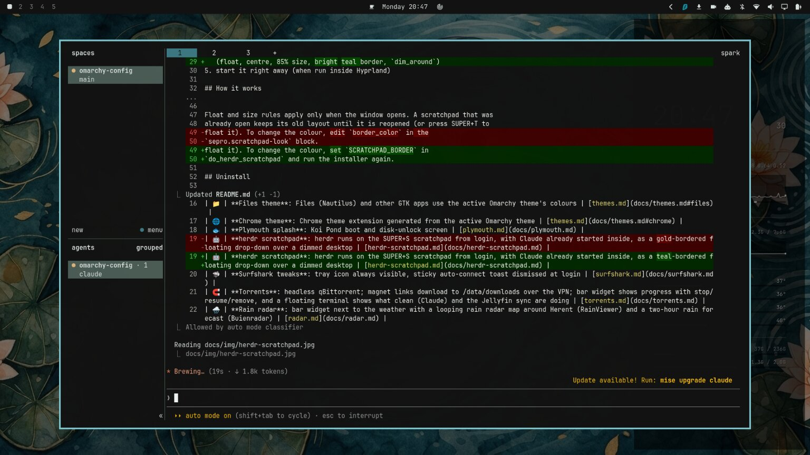

# herdr scratchpad — for Omarchy

At login, a terminal running [herdr](https://herdr.dev) opens on Hyprland's
built-in scratchpad, with a Claude agent already started in its first pane.
Press **SUPER+S** to show or hide it. Nothing appears on your normal
workspaces.

So it can't be mistaken for an ordinary terminal, it opens as a centred
floating drop-down at 85% of the screen, with a 3px bright teal border and the rest
of the screen dimmed. The colour is Koi Pond's `bright_cyan` (`#7ec3cc`), a
lighter version of the teal accent (`#3C7882`) that normal windows use.



---

## Install

```sh
./install.sh herdr-scratchpad
```

It will:

1. warn if `herdr` or `claude` isn't installed, and install `jq` if it's missing
2. copy `herdr-scratchpad.sh` into `~/.config/hypr/scripts/`
3. add a window rule and a launch line to `~/.config/hypr/autostart.lua`
4. add a `sepro.scratchpad-look` window rule to `~/.config/hypr/hyprland.lua`
   (float, centre, 85% size, bright teal border, `dim_around`)
5. start it right away (when run inside Hyprland)

## How it works

- `autostart.lua` runs the script once Hyprland starts. A window rule sends
  any window with class `org.omarchy.herdr-scratchpad` to
  `special:scratchpad`, and `silent` stops it from taking focus.
- The script opens herdr in the default terminal with that class, using
  `omarchy-launch-tui`. If that window is already open, it skips this step.
- It waits for the herdr server to report a pane. If no agent is running yet,
  it calls `herdr agent start claude --kind claude --pane <pane>`, so herdr
  tracks Claude as an agent.

Running the script a second time won't open another window or start another
Claude. herdr keeps its session on a server, so closing the terminal doesn't
stop Claude. Run the script again, or run `herdr`, to reattach.

Float and size rules apply only when the window opens. A scratchpad that was
already open keeps its old layout until it is reopened (or press SUPER+T to
float it). To change the colour, set `SCRATCHPAD_BORDER` in
`do_herdr_scratchpad` and run the installer again.

## Uninstall

Delete the three `herdr-scratchpad` lines from `~/.config/hypr/autostart.lua`,
delete the `sepro.scratchpad-look` block from `~/.config/hypr/hyprland.lua`,
then `rm ~/.config/hypr/scripts/herdr-scratchpad.sh`.
